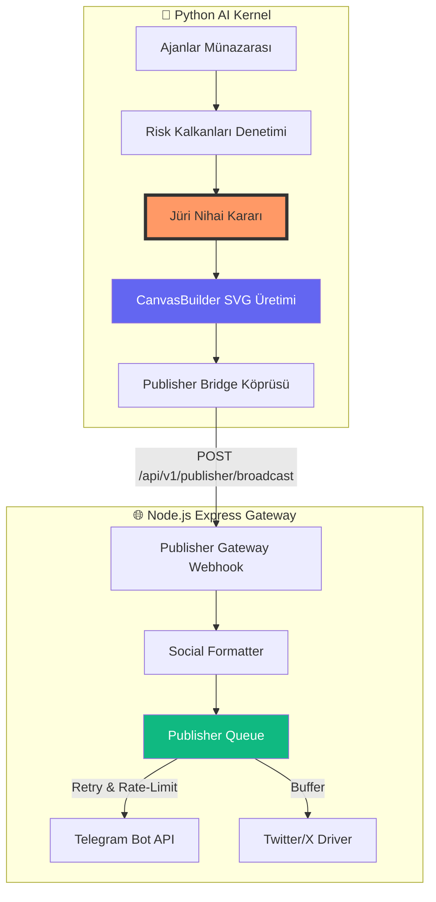

# 🏛️ BistApp (MT16) Mimari İndeksi ve Teknik Dokümantasyon

Bu doküman, BistApp MT16 Kuant Hedge Fund Terminali'nin hibrit (Python AI Kernel + Node.js Gateway) mimarisini, modül bağımlılıklarını ve veri sözleşmelerini tanımlar.

---

## 1. 📂 Proje Dosya Ağacı (Directory Tree)

```text
/
├── python/                         # 🧠 AI Kernel (Debate & Analysis Engine)
│   ├── kernel/
│   │   └── generator/              # 🎨 SVG Karar Kartı Jeneratörü
│   │       ├── __init__.py         # Gateway Köprüsü (transmit_to_publisher)
│   │       ├── canvas_builder.py   # SVG Vektör Çizim Motoru
│   │       └── card_templates.py   # FinTech Dark-Mode Şablonları
│   ├── orchestrator.py             # 🎼 Ana Orkestratör (Ajan Akışı)
│   ├── debate.py                   # ⚔️ Münazara & Kalkan Motoru
│   ├── schemas.py                  # 📋 Python Veri Modelleri
│   ├── server.py                   # ⚡ FastAPI Sunucusu (Rest API)
│   └── ... (Ajanlar & Motorlar)
├── server/                         # 🌐 Node.js Gateway (Publisher & Web)
│   ├── publisher/                  # 📢 Sosyal Medya Dağıtım Motoru
│   │   ├── drivers/                # 🔌 Platform Sürücüleri (Telegram)
│   │   ├── formatter.ts            # 🎭 Mesaj Formatlayıcı (Markdown V2/X)
│   │   ├── queue.ts                # ⏳ Rate-Limit Korumalı Kuyruk
│   │   └── index.ts                # 🚦 Dağıtım Orkestratörü
│   ├── routes/
│   │   └── publisher.ts            # 🛣️ /api/v1/publisher/broadcast Rotası
│   ├── services/
│   │   └── universalAnalystEngine.ts# 🏛️ Evrensel Karar Hakemi
│   └── index.ts                    # 🚀 Express.js Ana Sunucusu
├── Dockerfile.node                 # 🐳 Node.js Konteyner Yapılandırması
├── Dockerfile.python               # 🐳 Python Konteyner Yapılandırması
└── docker-compose.yml              # 🏗️ Çoklu Konteyner Orkestrasyonu
```

---

## 2. 🗺️ Modül Bağımlılık Haritası (Dependency & Flow Map)

BistApp, Python'un derin analiz gücü ile Node.js'in asenkron yayın yeteneklerini birleştirir.



### Karar Akışı Özeti:
1. **Analiz**: Python Ajanları (Teknik, Takas, Duygu vb.) veriyi işler.
2. **Münazara**: `debate.py` içerisinde kalkanlar çalışır, çelişkiler jüriye gider.
3. **Görselleştirme**: `canvas_builder.py` paylaşıma hazır 1200x675 SVG kart üretir.
4. **İletim**: Python tarafındaki `transmit_to_publisher` fonksiyonu veriyi Node.js gateway'ine fırlatır.
5. **Yayın**: Node.js tarafında mesajlar formatlanır, kuyruğa alınır ve sosyal medya kanallarına dağıtılır.

---

## 3. 📝 Veri Sözleşmesi (Data Contract)

Python AI Kernel ile Node.js Gateway arasındaki iletişim **`JuryDecisionPayload`** protokolü üzerinden sağlanır.

### Protokol Eşleşme Tablosu

| Alan (Field) | Tip (Python / TS) | Açıklama |
| :--- | :--- | :--- |
| `ticker` | `str` / `string` | Varlık Kodu (Örn: #THYAO, #BTCUSDT) |
| `verdict` | `Enum` / `Verdict` | Nihai Karar (STRONG_BUY, BUY, HOLD, vb.) |
| `confidenceScore`| `float` / `number` | Karar Güven Skoru (0-100) |
| `entryZone` | `str` / `string` | Önerilen Giriş Bölgesi / Aralığı |
| `targetPrice` | `str` / `string` | Hedef Satış Fiyatı |
| `stopLoss` | `str` / `string` | Zarar Kes Seviyesi |
| `activeShields` | `List[str]` / `string[]` | Tetiklenen Güvenlik Kalkanları |
| `reasoning` | `str` / `string` | Analiz Özeti ve Karar Gerekçesi |
| `svgCard` | `str` / `string` | Base64 veya Ham SVG XML İçeriği |

### TypeScript Interface Tanımı:
```typescript
interface JuryDecisionPayload {
  ticker: string;
  verdict: 'STRONG_BUY' | 'BUY' | 'HOLD' | 'SELL' | 'STRONG_SELL';
  confidenceScore: number;
  entryZone: string;
  targetPrice: string;
  stopLoss: string;
  activeShields: string[];
  reasoning: string;
  svgCard?: string;
  timestamp?: string;
}
```

---

## 4. 🚀 Operasyonel Süreçler

- **Python Bağımlılıkları**: `requirements.txt` üzerinden kurulur (FastAPI, yfinance, etc.).
- **Node.js Bağımlılıkları**: `package.json` üzerinden kurulur (Express, tsx, socket.io).
- **Haberleşme**: Konteynerlar arası ağ (Docker Network) üzerinden `http://python-backend:8001` ve `http://node-server:3000` adresleri kullanılır.
- **Güvenlik**: API anahtarları ve sırlar `.env` dosyasında saklanır; Python tarafında kalkanlar aracılığıyla manipülasyon denetimi yapılır.
